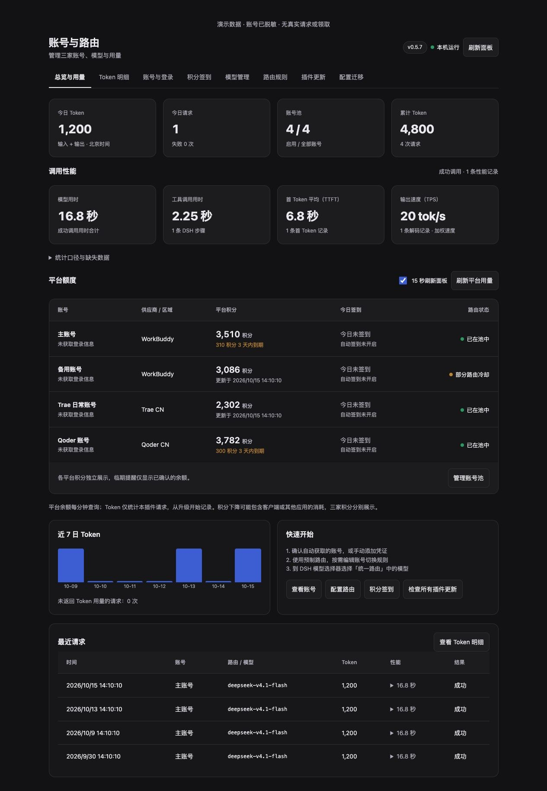
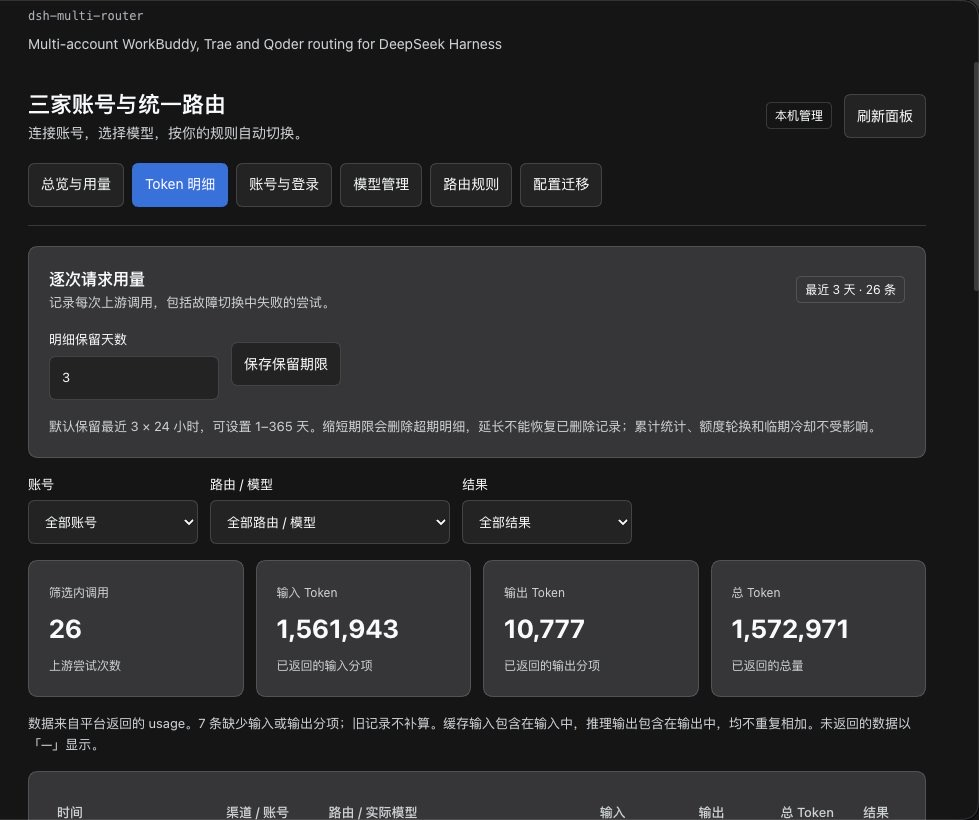
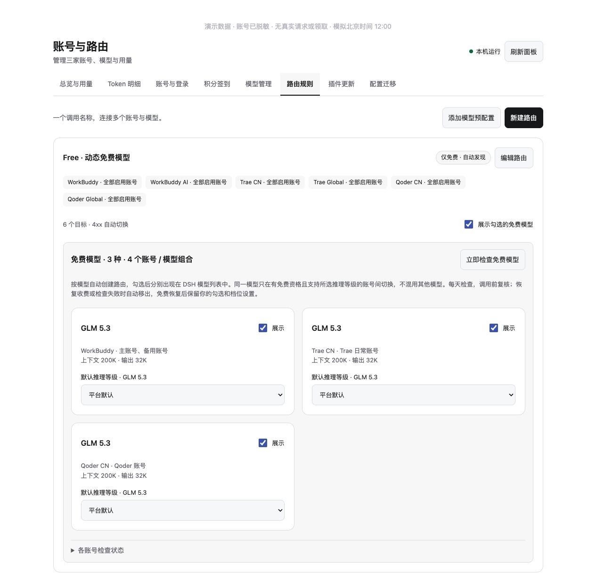
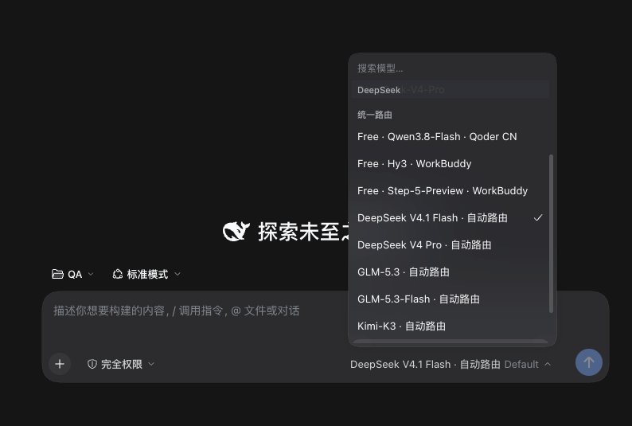

# DSH Multi Router

> ⚠️ **仅供个人学习、研究和技术交流使用。** 本项目与 WorkBuddy / Trae / Qoder / DeepSeek 官方无任何关联，不内置任何账号或凭证。解析客户端本地登录态或调用平台未公开接口**可能违反上游服务条款**，使用前请务必阅读 [免责声明](./DISCLAIMER.md)。
>
> **For personal study and research only.** Not affiliated with any vendor. See [DISCLAIMER.md](./DISCLAIMER.md).

一个插件内置 WorkBuddy、Trae、Qoder 的认证、模型发现和聊天传输，提供三家的多账号池及集中路由。运行不依赖原来三个 DSH 插件；三家代码随安装包一起打包。基于 MIT 上游，固定版本见 `upstream-lock.json`，许可见 `THIRD_PARTY_NOTICES.md`。

版本：0.3.8。适配 DSH Desktop / Web 0.2.0-rc.2，Node.js ^22.19.0 或 >=24。

## 在 DSH 里管理

打开 **插件 → dsh-multi-router 的配置页**。默认进入总览，六个页签：

- **总览与用量**：今日/累计请求与 Token、近 7 日趋势、最近请求、三家平台余额与刷新时间。平台每分钟查询，面板每 15 秒刷新，可暂停面板自动刷新。
- **Token 明细**：每次上游调用的时间、渠道、账号、路由、实际模型、输入/输出/总 Token 和结果；按账号、路由、结果筛选，每页 50 条。缓存输入和推理输出在平台返回时展示，不重复计入总量。默认滚动保留最近 3 × 24 小时，可设置 1–365 天，并随配置迁移。旧记录缺少的分项显示「—」。
- **账号与登录**：启动时自动读取本机 WorkBuddy / Trae 已登录账号，每分钟重新检测；Trae 自动识别 CN / Global / SOLO，面板展示检测状态，并提供「重新检测本机登录」。添加账号弹窗也可一键获取；账号 ID 自动生成、显示名自动识别，重复账号会提示。Qoder 使用 PAT，可粘贴或获取本机旧连接器已保存的 PAT。新账号自动获取模型与平台用量。详情弹窗查看身份、认证类型、有效期、刷新能力、套餐与积分包；账号可命名、启停、排序和移出。
- **模型管理**：原始模型默认隐藏，只展示统一路由；提供所有渠道「全部展示」「全部隐藏（仅路由）」，作用于现有和以后发现的模型。可搜索、获取真实模型目录，修改显示名与单模型展示开关，每家独立保存。
- **路由规则**：Free 免费路由排在首位，显示各账号当前免费模型与目录检查时间，支持立即检查。列表显示路由名称、切换策略和目标；新建/编辑打开二级弹窗。「添加模型预配置」可逐个添加或补齐全部三家预配置，不覆盖已有同 ID 路由。模型可从下拉列表选择，候选 ID 和上下文长度放在高级选项中。

- **配置迁移**：导入 / 导出设置，或使用密码加密迁移账号登录凭证。

保存即时生效；CLI / 手工修改 router.json 也会自动加载。无效配置保留最后一份有效运行配置，写入冲突返回 409，避免覆盖其他页面刚保存的修改。

原始模型 ID 用于上游协议。面板新建路由只填写名称，内部 ID 自动生成；编辑名称保留 ID，不影响已有会话引用。已有路由和预配置的内部 ID 保持兼容，面板不再提供 ID 配置。

隐藏只影响模型选择器，已有会话及路由仍可使用隐藏模型；停用账号会将其从新请求的候选池中排除。移出账号池保留独立凭证文件，且禁止移除仍被路由明确绑定的账号。

### 界面预览

| 总览与用量 | Token 明细 |
| --- | --- |
| 今日 / 累计 Token、账号池状态与三家平台余额 | 逐次上游调用、输入 / 输出分项与保留期限设置 |
|  |  |

| 路由规则 · Free 动态免费模型 | DSH 会话模型选择器 |
| --- | --- |
| 六个渠道目标 + 按模型自动创建的免费路由 | 「统一路由」分组置顶 Free 与各预配置 |
|  |  |

> 截图取自作者本机环境，其中的账号 ID、积分余额与 Token 用量为**真实数值**（非凭证，不含任何 Token / PAT / 身份信息）。插件本身不记录、不上传凭证，凭证仅保存在本机 `~/.dsh/multi-router/`（权限 0600）。

## 内置渠道与默认路由

内置 provider：`workbuddy`、`workbuddy-ai`、`trae`、`trae-global`、`qoder`、`qoder-global`。每个渠道直接使用本插件的账号池及传输，4xx 自动切下一账号。原有三个连接器需要关闭，避免同名 provider 冲突；仅关闭，不要求卸载，也不会修改其凭证。

`multi-router` 是集中路由渠道。可添加默认 `deepseek-v4.1-flash` 路由：

| 目标顺序 | 内置渠道 | 候选模型 ID |
| --- | --- | --- |
| 1 | WorkBuddy | deepseek-v4.1-flash / DeepSeek-V4.1-Flash / DeepSeek-V4.1-Flash-Official |
| 2 | Trae CN | deepseek-v4.1-flash / DeepSeek-V4.1-Flash / DeepSeek-V4.1-Flash-Official |
| 3 | Qoder CN | dfmodel |

候选 ID 按顺序选择目录中存在的第一个，不会调用目录不存在的模型。某账号无此模型就跳过。预配置可修改，不覆盖已有同名路由。

Qoder 的 `dfmodel` 在真实目录里显示为 DeepSeek-Flash，未声明具体版本。默认预配置将它纳入 Flash 统一路由；这不代表三家公布的版本名称完全相同。其他模型和国际区域请按账号真实目录配置。

旧版 `ds4.1f` 配置与独立凭证兼容保留。全新初始化也附带此别名；未显式配置目标 ID 时，仅匹配明确的 V4.1 Flash。路由配置可为空，三家内置渠道仍能使用。

## 账号隔离与切换

每个账号有独立的凭证、刷新副本、Trae 设备身份、Qoder transport/token 缓存。登录另一个账号后用新 ID 导入即可保留前一账号；同一账号导入两次或创建两个 PAT 不会增加上游额度。

所有上游 400–499 都切换，包括模型、权限、额度、限流和输入错误。输入 JSON 无效、未知本地模型等本地错误直接结束。401、402、429 冷却该账号全部路由；其他 4xx 冷却当前路由。默认冷却 60 秒，按账号池顺序和目标顺序尝试，成功账号优先承接下一次请求。每次请求每个账号/实际模型最多调用一次，耗尽返回 `account_pool_exhausted`。

耗尽类错误（`account_pool_exhausted` / `free_model_pool_unavailable` / `credit_usage_unavailable` / `unknown_model` / `upstream_failed`）在 message 末尾附带中文提示，响应 JSON 同时返回独立的 `hint` 字段：本次全部候选失败并进入冷却、纯冷却期内再次请求（含最短剩余秒数）、候选目录均无该模型 / 推理档位 / 免费资格不满足、没有可用账号目标、Token / 积分轮换暂停、5xx 未开启切换等分别给出对应说明。上游私有文案仍被剥离，只保留账号、状态码与错误类别。

5xx / 网络错误默认结束，设置 `retryServerErrors` 可启用切换。开始输出文本、推理或工具调用后不重放请求；取消请求也不触发换号。Harness 层重试为 0，由插件统一控制。

## 权重、额度与临期积分

每条路由可选 `strategy`：

| 值 | 规则 | 目标配置 |
| --- | --- | --- |
| `failover`（默认） | 顺序尝试，成功账号接续，4xx 切换 | 无额外字段 |
| `weighted` | 平滑加权轮询分配请求，例如 3:1 约为 75%:25% | `weight`，正整数，默认 1 |
| `tokens` | 每个账号达到本轮 Token 额度后切换，全部可用额度用完后开启新轮 | `tokenBudget`，正整数 |
| `credits` | 每个账号本轮观察到的积分余额下降达到阈值后切换 | `creditBudget`，正数 |

目标选择「全部启用账号」时，规则数值对其中每个账号生效；给账号设置不同权重/额度时，各建一个指定账号目标。Token 统计输入 + 输出，缓存用量不额外重复相加。平台没有返回可计量 Token 时不会当作 0 无限使用，该账号暂停参与此路由的 Token 额度轮换。

`preferExpiringCredits: true` 开启「优先使用临期积分」，`expiringWithinDays` 默认开启，临期范围默认 7 天，可在弹窗调整。只优先仍有余额、平台返回有效期且在窗口内到期的积分包，越早到期越优先；高于普通顺序和权重，仍遵守额度、禁用和冷却。无有效期/过期用量/查询失败时不猜测临期。Qoder 若只提供整个套餐有效期，则按其整体期限显示。WorkBuddy 日期时区沿用原客户端的本机解析。

额度只决定下一次请求选哪个账号，不中断正在生成的回答；并发请求、最后一次请求可能使阈值超过，积分结算延迟也可能造成超额。这是轮换阈值，不是上游消费硬上限。

统计保存于配置旁的 `usage.json`，0600 权限。仅保存账号/路由元数据、计数、平台额度和保留期限内的逐次调用明细，不保存提示词、回答或认证凭证；明细默认保留最近 3 天（滚动 72 小时），由 `usageRetentionDays` 设置 1–365 天，不再限定 80 条；缩短期限立即删除超期明细，延长不会恢复已删除记录。累计用量、额度轮换基线、临期冷却不清零，日趋势独立保留最近 31 天。Token 从本版本启用后开始计量，不回填历史会话。三家积分单位分别展示，不汇总为通用余额；平台余额下降可包含其他应用消费、积分包到期或延迟结算，不宣称是精确的单请求扣费。平台查询失败保留最后数据与错误、时间；没有可用积分数据的账号不参加积分阈值轮换。

账号获取采用官方客户端已有登录文件的只读解析，不修改客户端登录、不复制参考项目代码、不自动签到。手动凭证支持 WorkBuddy / Trae 字段表单、三家凭证 JSON 和 Qoder PAT；凭证格式、区域、Trae 设备身份会校验。已有账号可在详情中「补充 / 更新凭证」，旧副本保留。Qoder 普通网页 Cookie 无法替代 PAT；官方 PAT 指引见 https://docs.qoder.com/cli/authentication 。

## 安装

### 方式一：GitHub 链接安装（首选）

在 DSH 的 **插件页 → 安装插件** 输入 GitHub 仓库地址：

```text
https://github.com/AndroidSix/dsh-multi-router
```

CLI 使用明确的 GitHub 依赖格式：

```bash
# Desktop profile
dsh plugin --profile desktop add github:AndroidSix/dsh-multi-router

# Web profile
dsh plugin --profile web add github:AndroidSix/dsh-multi-router
```

默认获取 main 分支；仓库已包含编译好的 `lib/`，安装端无需 clone、构建或运行初始化命令，也没有安装时构建脚本。首次启用自动在当前设备的 DSH 数据目录创建配置及预制路由，并读取本机已登录的 WorkBuddy / Trae 账号，无需先手动添加。Qoder 使用 PAT，或读取旧连接器保存的 PAT。凭证只保存独立副本；再次检测不会重复添加，也不会启用已停用账号。移出的本机账号不会被定时扫描重新加入，可点击「重新检测本机登录」主动恢复。已有配置不会被覆盖；损坏的配置也不会自动重置。安装 / 更新 / 卸载后需**完全退出并重启**对应的 DSH 进程生效。

已安装用户更新（也适用于旧版从本地 `.tgz` 安装的用户）：

```bash
dsh plugin --profile desktop add github:AndroidSix/dsh-multi-router
```

这会将同名插件的安装源切换为 GitHub 并获取当前版本，账号、路由和统计保存在包目录之外，不会随包替换。旧的 `file:...tgz` 依赖绑定一个固定本地文件，普通更新不会自动改为 GitHub 来源。已经使用 GitHub 来源时，也可以执行 `dsh plugin --profile desktop update dsh-multi-router`。安装后的运行进程仍需完全退出并重启；「刷新面板」只刷新账号和用量，不会更新插件代码。GitHub 提交、GitHub Releases 和 npm 版本是不同发布来源，第三方商店是否提示更新取决于其检测方式。

Desktop 若提示 CLI 仅安装依赖、未自动启用 bundle：完全退出 Desktop 后，在 desktop profile 的 `package.json` 的 `dsh.profile.bundles` 数组里追加 `"dsh-multi-router"`（保留其他 bundle），再启动并打开配置页。

> 首次安装请先在 DSH 中**关闭**原 WorkBuddy / Trae / Qoder 三个独立连接器（仅关闭，不必卸载，不影响其凭证），避免同名 provider 冲突。

### 方式二：本地构建 / 离线包

```bash
git clone https://github.com/AndroidSix/dsh-multi-router.git
cd dsh-multi-router
npm ci
npm run check
npm run pack:release
dsh plugin --profile desktop add ./dsh-multi-router-0.3.8.tgz
```

### 配置账号

安装后直接在配置面板「账号与登录」添加；也可先用 CLI：

```bash
node lib/cli.js add --id wb1 --provider workbuddy --source '/path/workbuddy-desktop.info'
node lib/cli.js add --id tr1 --provider trae --edition cn --source '/path/Trae CN/User/globalStorage/storage.json'
node lib/cli.js add --id qd1 --provider qoder --source '/path/account-pat.txt'
```

默认配置路径：`~/.dsh/multi-router/router.json`。配置文件、凭证权限 0600，凭证目录 0700。普通账号列表、状态响应和路由日志不输出 Token / PAT；仅用户主动提取单账号凭证或加密迁移时返回必要登录信息，不导出 Trae 私钥。

v0.3.6 及之前在新设备可能因 `router.json` 尚不存在而启用失败（ENOENT），面板继而显示 JSON 解析错误。更新到 v0.3.7 后重启即可自动初始化；无需从其他设备复制配置文件。如暂时无法更新，可在该设备已安装的包目录运行 `node lib/cli.js init` 后重启（仅适用于尚无配置的设备）。不要复制旧设备的绝对凭证路径，账号跨设备迁移使用面板「配置迁移」。

管理接口仅接受本机同源请求，写操作需要当前页面取得的随机控制密钥。内部流式接口仅监听随机 127.0.0.1 端口，并由随机密钥认证；它们不是公开 API。

## CLI 与配置

```bash
node lib/cli.js status
node lib/cli.js models --id wb1
node lib/cli.js disable --id wb1
node lib/cli.js enable --id wb1
node lib/cli.js remove --id wb1
```

`--config /absolute/path/router.json` 指定账号池；DSH Loader `llm-multi-router` 的 `configFile` 指向同一文件。也可设置 DSH_MULTI_ROUTER_CONFIG。

`router.example.json` 提供结构示例。`models` 中的 preferences 按 provider / 真实模型 ID 存放 `name` 和 `visible`；`routes` 按路由调用 ID 存放名称、预算、显隐和目标。

`modelVisibility` 按供应商保存新发现模型的展示默认值，省略时为 false。单模型 `visible` 优先；批量操作同时更新渠道默认值和已有单模型覆盖项，保留模型名称和路由配置。完整配置导入 / 导出也保留该默认值。

## 三家模型预配置（0.3.5）

新增 Free 自动免费路由，并保留以下七种国内渠道共有模型路由。每条默认 WorkBuddy → Trae → Qoder，使用该渠道全部启用账号，临期优先开启，200K 上下文 / 32K 最大输出。Flash 仍采用用户已允许的三家 Flash 兼容切换；其他预配置精确绑定对应版本，不混用 GLM FlashX 等变体。目录或账号权限变化可能使目标暂不可用，预配置弹窗显示当前已发现可用渠道数。

| 路由调用 ID | WorkBuddy 目标 ID | Trae 目标 ID | Qoder 目标 ID |
| --- | --- | --- | --- |
| deepseek-v4.1-flash | deepseek-v4.1-flash 等既有候选 | deepseek-v4.1-flash 等既有候选 | dfmodel |
| deepseek-v4-pro | deepseek-v4-pro | DeepSeek-V4-Pro-Official / DeepSeek-V4-Pro | dmodel |
| glm-5.3 | glm-5.3 | glm-5.3 | gmodel |
| glm-5.3-flash | glm-5.3-flash | glm-5.3-flash | gfmodel |
| kimi-k3 | kimi-k3-1 | kimi-k3 | kmodel_latest |
| kimi-k2.8-preview | kimi-k2.8-preview | kimi-k2.8-preview | kmodel |
| minimax-m2.7 | minimax-m2.7 | minimax-m2.7 | mmodel |

路由内部 ID 是 DSH 查找路由所需的标识，由插件维护；用户在面板只配置路由名称。目标模型 ID 决定实际调用哪个模型。上表为预配置的稳定内部标识，新建路由自动生成独立标识。GLM-5.2 已移出预配置，原始渠道模型不受影响。

## Free 动态免费模型（0.3.6）

预配置内置 free 管理组，名称「Free · 动态免费模型」，排在预配置与路由管理列表首位。按确切的渠道与模型 ID 自动创建各模型的免费路由，DSH 模型列表分别展示「Free · 模型名 · 渠道」，排在普通预配置前。同一渠道同一模型的多个免费账号归为一个路由，不按展示名称模糊合并版本，也不把不同模型混为一个池。原 free 内部标识仅为旧会话保留，默认不在选择器展示。

面板可逐个勾选免费模型的展示，并设置默认推理等级。DSH 会话内的显式选择优先于面板默认。未声明可调档位的模型只使用平台默认，不编造等级。展示与档位设置按稳定的模型路由标识保存，恢复免费、更换账号、重启后保留；配置迁移也保留。之前选择的档位若已不受支持，会显示提示并暂用平台默认。管理组开关控制所有已勾选免费模型的展示。

按北京时间每天检查官方模型目录：启动补查，每分钟检查是否跨日，同一天成功检查的目录无需定时重复拉取；失败五分钟后重试。目录和日期 / 价格字段版本保存到 catalogs.json，重启保留。DSH 未运行期间不会唤醒应用；下次启动补查。面板提供「立即检查免费模型」。每次 Free 调用前额外强制刷新目录，绕过模型缓存并合并并发刷新；每个候选发送前再检查倍率与限免时间窗。

仅目录明确返回零倍率的模型入池：WorkBuddy / Qoder 使用 billing.credits，Trae 使用 creditMultiplier；不依据宣传名称、免费积分、套餐名称或 DSH 适配器的占位成本判断。价格未知、收费、已结束限免、过期目录或目录检查失败的账号不参与。4xx 只在同一模型的免费账号间切换，成功账号继续承接请求；不会把 Step 的会话自动转到 Qwen 或 Hy3。沿用全局设置的 5xx 切换选项，不重放已经输出的内容。无确认免费目标返回不可用，不回退到其他或付费模型。资格与费率由平台实时决定，目录复核不能锁定平台后续账单。

Free 不使用临期积分或 Token / 积分额度策略，避免将「消耗赠送积分」当成免费。可编辑管理组名称、展示开关及移除。各模型的上下文 / 输出能力只取该模型免费候选账号中的保守值；实际调用模型保存在 Token 明细中。动态目录在新设备重新发现。

## 统一路由推理模式

所有预配置与自定义路由保留各目标明确声明的全部档位，包括支持的 Off、Minimal、Low、Medium、High、XHigh、Max。不同渠道存在差异时使用并集，并按会话所选档位筛选实际账号 / 模型候选，不静默降级，也不因某个目标未声明档位而删掉其他目标的能力。WorkBuddy 国内 onlyReasoning 的模型仍遵守上游禁止 Off 的约束。平台默认与显式 Off 通过每次请求独立的本机 shim 头区分，头不发送到三家上游；实际请求仍使用各渠道本来的字段映射。

## 开发与验证

```bash
npm ci
npm run fetch-upstream
npm run build
npm test
npm pack --cache /private/tmp/dsh-multi-router-npm-cache
```

安装包包含编译后的主机和浏览器代码，无需安装时构建，运行时无需 upstream 源目录。React 与 DSH 公共接口作为宿主共享 peer，三家传输代码直接打进 lib。

离线测试覆盖三家独立快照、原始 provider 的多账号切换、模型命名和显隐、路由 CRUD / 顺序 / 预配置、写入冲突、管理接口、流内错误、取消、迁移及单账号凭证往返。真实账号验证属于使用者本机行为，本仓库不记录也不包含任何真实账号、用量或凭证数据。

宿主组件使用包根入口 `dsh-multi-router`。DSH 的前端发现会跳过 `/host` 等包子路径；不要将宿主入口改成这类子路径，否则配置面板不会加载。

## 临期优先三天冷却（0.3.1）

临期优先默认开启，默认范围 7 天，可关闭。只有临期账号积分耗尽或达到各自 Token / 积分轮换额度，才记为本轮完成；平台查询失败不会当成耗尽。所有参与本轮的临期账号完成后，临期优先暂停 72 小时，期间继续普通路由和 4xx 故障切换，补充积分不会自动打断冷却。冷却到期后有符合条件的积分包时开始新轮。状态保存在 usage.json，重启保留。路由卡片与弹窗显示本轮进度 / 冷却时间；「强制开启并开始新一轮」清除临期冷却并重置此路由本轮额度基线，累计用量保留。

## 配置导入 / 导出（0.3.1）

在「配置迁移」导出账号名称与顺序、模型展示、路由和切换设置。默认仅配置，不包含登录凭证、原机器文件路径、管理密钥、会话、用量统计或冷却运行状态。新设备缺少凭证的账号会停用，可在账号详情补充凭证。

勾选「同时迁移账号登录凭证」后，迁移密码至少 10 字符，使用随机 salt 的 scrypt 派生密钥和 AES-256-GCM 加密整个迁移内容，包括 WorkBuddy / Trae Token、Qoder PAT 及必要的 Trae 身份。密码不保存，跨设备需相同密码解密。平台可能绑定设备或撤销凭证，导入不能保证绕过平台的重新登录要求。

选择文件、填写加密密码、选择合并或替换、检查预览、确认导入。合并保留本机额外账号与路由，更新同 ID 项；不带凭证的同 ID 账号保留本机凭证。带凭证则生成新的本机私有副本。替换使用文件完整配置，原账号文件仍保留。导入先验证并暂存凭证，成功后原子替换配置；失败不改变原配置。每次导入自动保存 router.json.before-import-*.bak（600 权限），通过原配置及保留的凭证文件可恢复。模型与用量在后台重新发现，不导入旧机器目录缓存。迁移文件仅由本机接口处理，不上传第三方。

## 单账号凭证复制与导出（0.3.2）

在「账号与登录」→「登录详情 / 管理」→「凭证提取与跨设备使用」点击「复制凭证 JSON」或「导出凭证 JSON」。单账号文件包含供应商 / 区域、账号名称、Token / PAT、有效期和刷新信息；Trae 同时携带必要的 machineId / deviceId / edition。不会携带本机文件路径、其他账号、路由、统计或私钥。只读取当前保存副本，不主动刷新登录。

新设备选择「添加账号」→「粘贴 / 选择凭证 JSON」，粘贴内容或选择导出的文件，会自动识别供应商 / 区域及账号名称；保存后生成新的本机私有凭证副本。更新现有账号时要求供应商一致。自动复制不可用时提供手动全选复制。提取使用带管理密钥的本机 POST 接口，响应禁止缓存，普通状态中不保存提取结果。

此处复制及导出均为明文，适合在自己的设备间快速传递；需要密码加密时使用「配置迁移」。平台可能绑定设备或撤销凭证，导入后仍可能需要重新登录。

## 上游项目与许可

本插件的认证解析、模型发现与聊天传输模块来自以下三个 MIT 许可的上游项目，源码按 `upstream-lock.json` 固定的 commit 引入 `upstream/` 目录，版权归各自作者所有：

| 上游 | 作者 | 许可 |
| --- | --- | --- |
| [`dsh-workbuddy-connect`](https://github.com/corrinehu/dsh-workbuddy-connect) | Corrine Hu | MIT |
| [`dsh-connect-trae`](https://github.com/dingminhua/dsh-connect-trae) | LaoDing | MIT |
| [`dsh-qoder-connect`](https://github.com/masknull/dsh-qoder-connect) | Corrine Hu | MIT |

完整的许可文本与本地改动说明见 [`THIRD_PARTY_NOTICES.md`](./THIRD_PARTY_NOTICES.md)。本项目自身以 MIT 许可发布（见 [`LICENSE`](./LICENSE)），但**使用与再分发本项目时必须同时保留上述上游的版权声明**。

## 许可与免责

- 代码许可：[MIT](./LICENSE)
- **使用条款与免责：见 [DISCLAIMER.md](./DISCLAIMER.md)——仅供个人学习研究，与官方无关，按「现状」提供，使用者自担风险。**

## 自动发版到 npm

仓库的 `.github/workflows/publish.yml` 在 GitHub Release 发布时运行：校验 `v版本号` 与 `package.json` / `package-lock.json` 一致 → 安装依赖 → 构建并运行全部回归 → 打包并附加到 GitHub Release → 通过 npm Trusted Publishing 发布。普通提交不触发发布；草稿 Release 也不发布。稳定版本使用 npm `latest`，预发布版本使用 `next`。失败后修复原因，再在 Actions 手动输入已有 tag 重试；已经成功发布的 npm 版本不能重复发布。

日常更新：修改版本号和更新日志，运行 `npm run check`，提交源码与编译产物，推送 main，然后创建对应 `v0.x.y` 标签的 GitHub Release。CI 的打包白名单不包含本机账号、配置、统计、npm 登录文件。

首次发布需 npm 账号完成双重验证。包的 npm Settings → Trusted Publisher 使用 GitHub Actions，填写组织 / 用户 `AndroidSix`、仓库 `dsh-multi-router`、工作流文件 `publish.yml`，环境名称留空，并允许 `npm publish`。不需要添加 `NPM_TOKEN` GitHub Secret。
